<h1 align="center">Forkly Food Delivery Performance Report</h1>
<p align="center"><em>2021–2025 · Python · pandas · NumPy · matplotlib · seaborn · Plotly · Dash · Jupyter</em></p>

<table align="center">
  <tr>
    <td width="1440">
      <h2 align="center">Company Background</h2>
      Forkly is a <strong>food and grocery delivery app</strong> operating in the Baltics, Poland and Finland. Customers order from partner restaurants through the iOS app, the Android app or the website, and Forkly's own couriers deliver by bicycle, e-bike, scooter or car. The company launched in <strong>4 cities in 2021</strong> and reached <strong>12 cities in 5 countries</strong> by 2025. It added the <strong>Forkly Plus</strong> subscription (free delivery) in 2023 and grocery delivery in 2024.<br>
      <br>
      Between 2021 and 2025 the app handled about <strong>300,000 orders</strong> from <strong>45,000 customers</strong> and <strong>2,900 restaurants</strong>, worth <strong>€7.2 million</strong> in gross merchandise value (GMV). The data covers customers, restaurants, menus, couriers, orders, order items, deliveries, reviews, support tickets, promotions, subscriptions, marketing spend and daily weather.<br>
      <br>
      I analysed five years of Forkly's data to answer four questions. Does Forkly make money on each order? Do customers come back? What does a late delivery cost? Which marketing spend pays off? The analysis focuses on these areas:
      <h3>Northstar Metrics</h3>
      <ul>
        <li><strong>Growth:</strong> GMV, number of orders, average basket and growth by city.</li>
        <li><strong>Unit economics:</strong> take rate, net revenue, contribution per order and contribution margin.</li>
        <li><strong>Customers and loyalty:</strong> cohort retention, year-over-year retention, RFM segments and Forkly Plus.</li>
        <li><strong>Delivery operations:</strong> delivery time, late rate, cancellations, ratings and support tickets.</li>
        <li><strong>Marketing:</strong> spend by channel, customer acquisition cost (CAC), cost per signup and promotion effects.</li>
      </ul>
    </td>
  </tr>
</table>

<h1 align="center">Executive Summary</h1>
<h3 align="center">Monthly Orders and GMV (2021–2025)</h3>
<div align="center">
  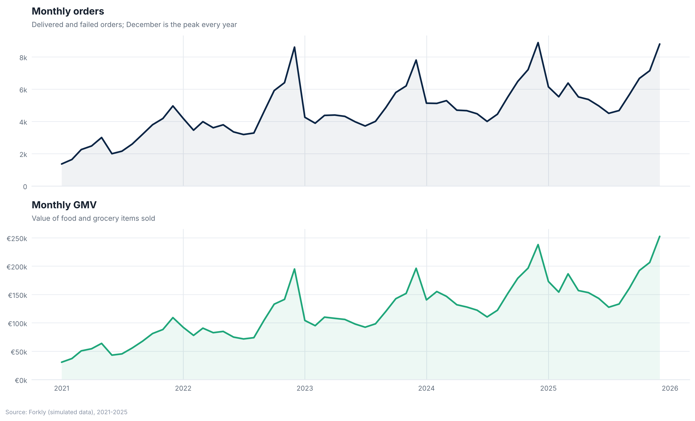
</div>
<table align="center">
  <tr>
    <td width="460" valign="top">
      <ol>
        <li>
          <strong>GMV Nearly Tripled</strong>
          <ul>
            <li>GMV grew from <strong>€0.73M in 2021 to €2.04M in 2025</strong>, and orders doubled from 36,000 to 74,000.</li>
            <li>The average basket rose from €21.70 to <strong>€28.60</strong>, helped by grocery orders (€30.50 on average).</li>
            <li>December 2025 was the best month on record at <strong>€253K</strong> of GMV.</li>
          </ul>
        </li>
        <li>
          <strong>From Losing Money to Profitable Orders</strong>
          <ul>
            <li>In 2021 Forkly lost <strong>€1.03 on every order</strong>, mostly because it paid for discounts itself. Since 2023 every order has made money, peaking at <strong>€2.12 in 2024</strong>.</li>
            <li>Contribution margin went from −4.8% to <strong>6.4%</strong>.</li>
          </ul>
        </li>
      </ol>
    </td>
    <td width="460" valign="top">
      <ol start="3">
        <li>
          <strong>The 2022 Operations Crunch</strong>
          <ul>
            <li>After launching three new cities, Forkly ran short of couriers. <strong>32% of deliveries were late</strong>, cancellations reached 9.3% and the delivery rating fell to 3.74.</li>
            <li>By 2025 the late rate was <strong>5.1%</strong> and the rating 4.51.</li>
          </ul>
        </li>
        <li>
          <strong>Key Takeaways &amp; Recommendations</strong>
          <ul>
            <li>Growth now comes from <strong>returning customers and new cities</strong>, not from discounts.</li>
            <li>Plan city launches around courier capacity. The 2022 crunch cut retention from 90% to 71%.</li>
            <li>Review the free-delivery benefit for Plus members, which cut the margin by 1.3 pp in 2025.</li>
          </ul>
        </li>
      </ol>
    </td>
  </tr>
</table>

<h2 align="center">Dataset Structure and ERD (Entity Relationship Diagram)</h2>
The database has <strong>15 tables</strong> with about <strong>1.5 million rows</strong> in total. <code>orders</code> (301,200 rows, including 1,200 planted duplicates) is the central fact table. Each order has its lines in <code>order_items</code>, one row in <code>deliveries</code>, and can have a review, a support ticket and a promotion. Customers, restaurants, menu items, couriers, cities and the calendar describe it, and <code>weather_daily</code> joins on city and date.
<div align="center">
  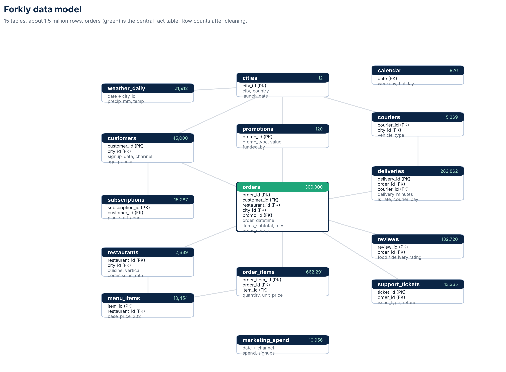
</div>

<h1 align="center">Insights Deep-Dive</h1>

<h1 align="center">Growth Trend</h1>
<table align="center">
  <tr>
    <td width="1000">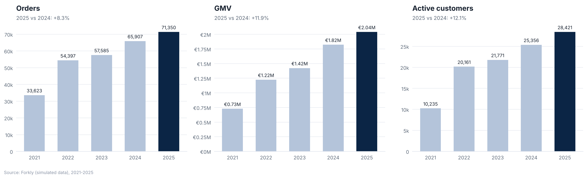</td>
    <td width="1000">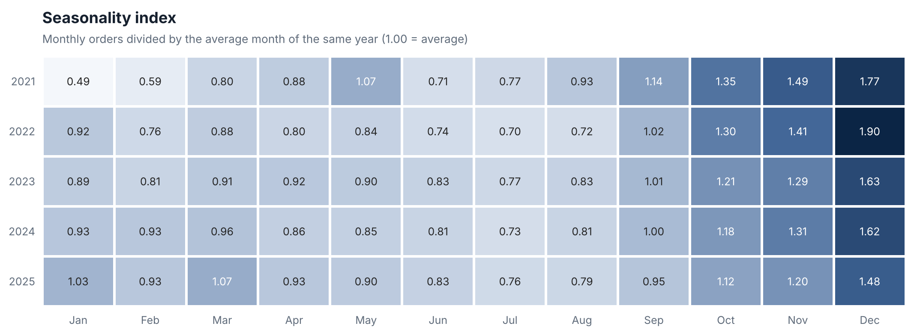</td>
    <td width="1000">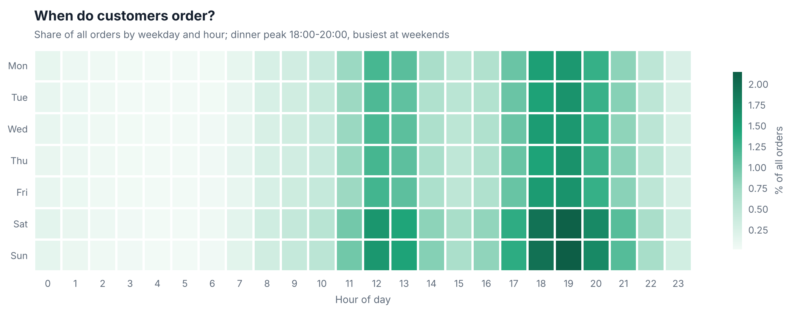</td>
  </tr>
</table>
<table>
  <tr>
    <td>
      <strong>GMV and Orders</strong>
      <ol>
        <li>Growth Every Year, Uneven Pace
          <ul>
            <li>GMV grew +68% (2022), +16% (2023), +28% (2024) and +12% (2025).</li>
            <li>Orders grew from 36,000 to 60,000 in 2022, then only 2% in 2023 when Forkly cut paid marketing and fixed operations.</li>
          </ul>
        </li>
        <li>2022 – Growth Without Profit
          <ul>
            <li>Orders grew 67%, but each order still lost money (−€0.19) and the late rate tripled to 32%.</li>
          </ul>
        </li>
        <li>2024 – Grocery and New Cities
          <ul>
            <li>Grocery delivery and three new cities (Helsinki, Gdansk, Daugavpils) brought GMV growth back to 28%.</li>
          </ul>
        </li>
      </ol>
      <strong>Average Basket</strong>
      <ol>
        <li>The average basket grew every year, from <strong>€21.70 in 2021 to €28.60 in 2025</strong>.</li>
        <li>Grocery baskets average €30.50, above every restaurant cuisine except sushi (€32.70).</li>
      </ol>
      <strong>When Customers Order</strong>
      <ol>
        <li>December is the strongest month every year, at <strong>1.5 to 1.9 times</strong> an average month. Since 2022, July has been the weakest.</li>
        <li>Dinner from 18:00 to 21:00 brings a third of all orders. Saturdays and Sundays are about <strong>30% busier</strong> than weekdays.</li>
      </ol>
    </td>
  </tr>
</table>
<div align="center">
  <h4>GMV, basket and rating grow while late deliveries and cancellations fall after 2022</h4>
  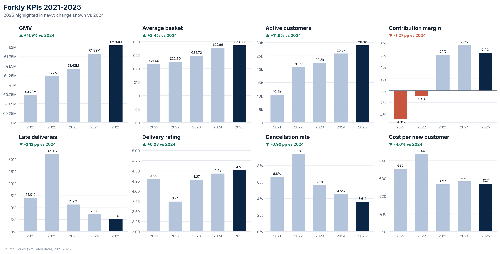
</div>

<h1 align="center">Unit Economics</h1>
<div align="center">
  <h3>Every Order Has Made Money Since 2023</h3>
  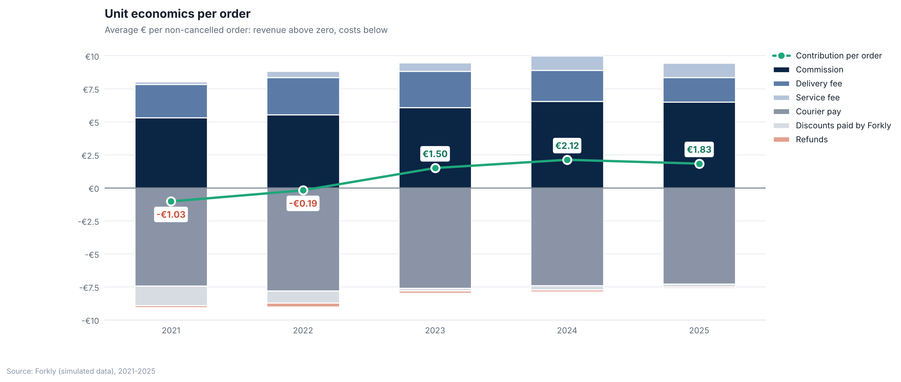
</div>
<table align="center">
  <tr>
    <td width="333" valign="top">
      <h3>Revenue per Order</h3>
      <ul>
        <li>Commission is the main income, growing from <strong>€5.32 to €6.51 per order</strong> as baskets got bigger.</li>
        <li>Service fees grew from €0.18 to €1.09. Delivery fees fell from €2.82 (2022) to €1.85, because Plus members pay almost nothing.</li>
        <li>The take rate peaked at <strong>37.4% in 2023</strong> and was 32.3% in 2025.</li>
      </ul>
    </td>
    <td width="333" valign="top">
      <h3>Costs per Order</h3>
      <ul>
        <li>Courier pay is the biggest cost every year, at about <strong>€7.30–7.80 per order</strong>.</li>
        <li>Discounts paid by Forkly fell from <strong>€1.49 to €0.21</strong> per order.</li>
        <li>Refunds peaked at €0.29 per order in 2022, during the operations crunch.</li>
      </ul>
    </td>
    <td width="333" valign="top">
      <h3>Contribution</h3>
      <ul>
        <li>Contribution per order went from <strong>−€1.03 (2021)</strong> to €1.50 (2023), €2.12 (2024) and €1.83 (2025).</li>
        <li>Total contribution was <strong>€130K in 2025</strong>, against a €35K loss in 2021.</li>
        <li>The 2025 dip comes from lower delivery fees as Plus grew to 42% of orders.</li>
      </ul>
    </td>
  </tr>
</table>
<table align="center">
  <tr align="center">
    <td width="1000" valign="top">
      <h3>Promotions</h3>
      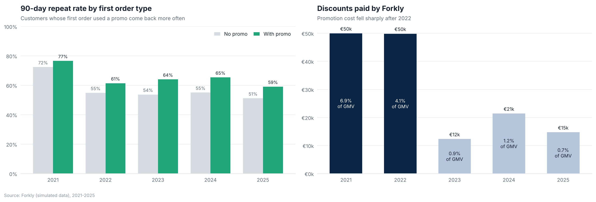
    </td>
    <td width="1000" valign="top">
      <h3>Platform, Payment and Promo Mix</h3>
      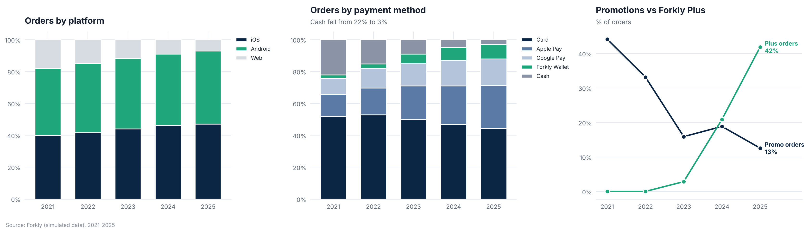
    </td>
  </tr>
</table>
<table>
  <tr>
    <td>
      <ul>
        <li>Promo orders fell from <strong>44% of orders in 2021 to 13% in 2025</strong>. Discounts paid by Forkly fell from 6.9% to <strong>0.7% of GMV</strong>.</li>
        <li>Promotions still work for first orders: customers whose first order used a promo are <strong>7–10 pp more likely</strong> to order again within 90 days (2022–2025).</li>
        <li>The website's share of orders fell from 18% to 7%. Cash fell from 22% to 3% of payments, while Apple Pay grew from 14% to 27%.</li>
      </ul>
    </td>
  </tr>
</table>

<h1 align="center">Customers and Forkly Plus</h1>
<table align="center">
  <tr align="center">
    <td width="1000">
      <h3>Year-over-Year Retention</h3>
      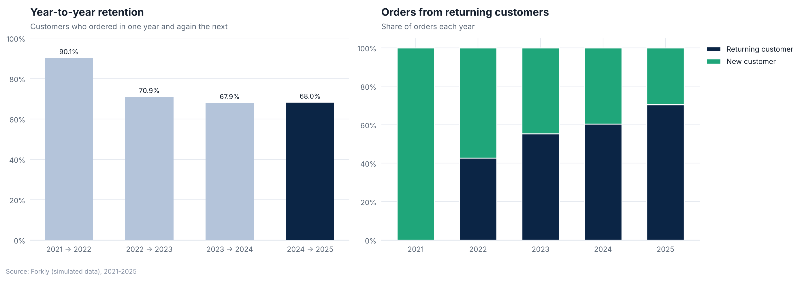
    </td>
    <td width="1000">
      <h3>Customer Retention by Cohort</h3>
      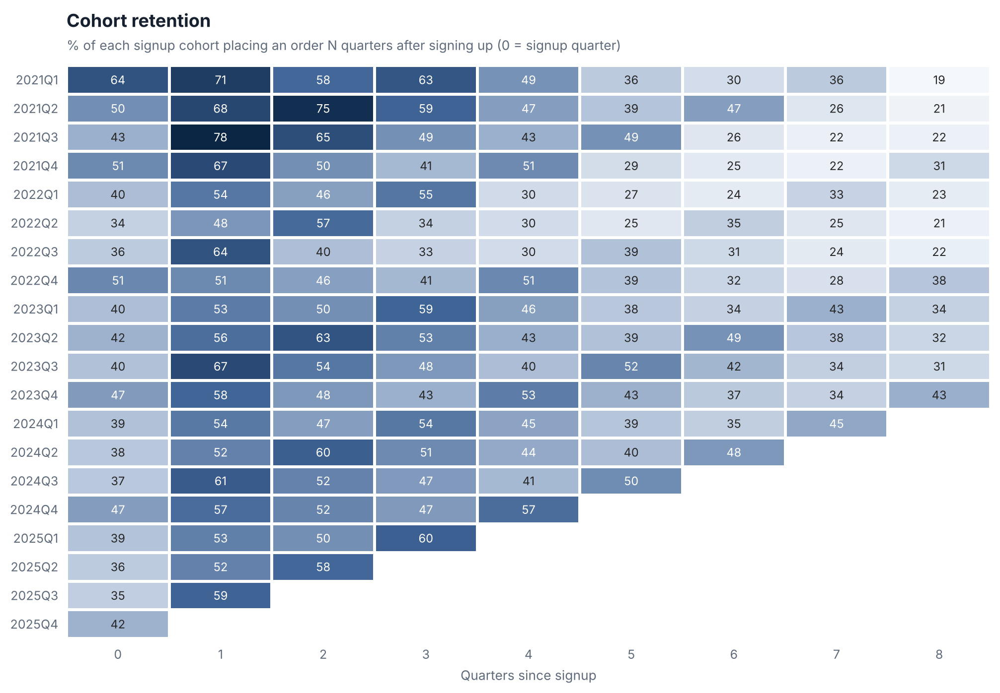
    </td>
  </tr>
</table>
<table>
  <tr>
    <td>
      <ul>
        <li>Returning customers placed <strong>71% of orders in 2025</strong>, up from 43% in 2022. New signups fell from 13,000 in 2022 to about 6,000–7,500 a year, so growth now comes from existing customers.</li>
        <li>Year-over-year retention fell from <strong>90%</strong> (2021 to 2022) to <strong>71%</strong> after the 2022 crunch and has stayed at about 68% since.</li>
        <li>Organic signups grew from 24% (2022) to <strong>38% of new customers</strong>, and referrals from 9% to 23%.</li>
        <li>RFM segmentation shows that <strong>Champions are 30% of customers but bring 69% of GMV</strong> over the last 12 months. A third of all customers are lost or inactive.</li>
      </ul>
    </td>
  </tr>
</table>
<table align="center">
  <tr align="center">
    <td width="1000">
      <h3>RFM Segments</h3>
      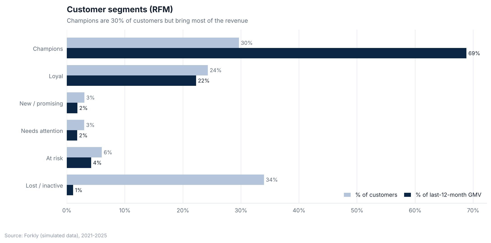
    </td>
    <td width="1000">
      <h3>Forkly Plus</h3>
      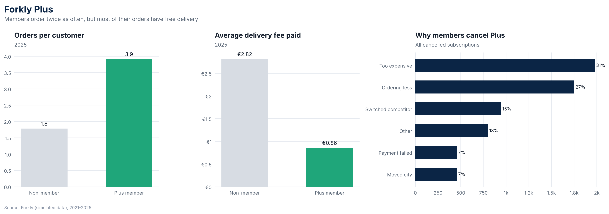
    </td>
  </tr>
</table>
<table>
  <tr>
    <td>
      <ul>
        <li>Plus orders rose from <strong>3% of orders in 2023 to 42% in 2025</strong>. Members order <strong>3.9 times a year</strong>, against 1.8 for non-members, with almost the same basket (€28.60 vs €28.90).</li>
        <li>Members paid €0.86 on average for delivery in 2025, against €2.82 for non-members.</li>
        <li>About 8,900 subscriptions were active at the end of 2025. The top cancellation reasons are "too expensive" (31%) and "ordering less" (27%).</li>
      </ul>
    </td>
  </tr>
</table>

<h1 align="center">Restaurants and Cities</h1>
<div align="center">
  <h3>Where GMV Growth Came From</h3>
  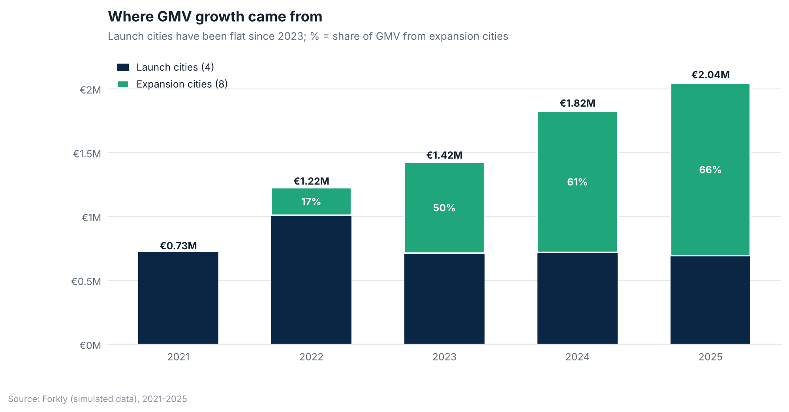
</div>
<table align="center">
  <tr>
    <td width="333" valign="top">
      <h3>Cities</h3>
      <ul>
        <li>GMV in the four launch cities peaked at <strong>€1.0M in 2022</strong> and has been about €0.7M a year since. All growth since 2023 comes from the eight newer cities.</li>
        <li>Newer cities brought in <strong>66% of 2025 GMV</strong>.</li>
        <li>Warsaw opened in September 2022 and is now the largest city, with <strong>€472K (23%)</strong> of 2025 GMV.</li>
      </ul>
    </td>
    <td width="333" valign="top">
      <h3>Cuisines</h3>
      <ul>
        <li>Grocery became the largest category within two years of launch, with <strong>17% of 2025 GMV</strong> (€347K).</li>
        <li>Pizza (13%), Burgers (12%) and Sushi (12%) follow.</li>
        <li>From 2023 to 2025 Breakfast &amp; Coffee grew fastest (+38%), followed by Kebab, Italian and Desserts (+27% each). Pizza grew only 11%.</li>
      </ul>
    </td>
    <td width="333" valign="top">
      <h3>Restaurant Partners</h3>
      <ul>
        <li>The <strong>top 20% of partners make 40% of GMV</strong>.</li>
        <li>Restaurant revenue is spread far more evenly than customer revenue, where 30% of customers make 69% of GMV.</li>
        <li>Average food ratings are similar across cuisines, between 4.2 and 4.3.</li>
      </ul>
    </td>
  </tr>
</table>
<table align="center">
  <tr align="center">
    <td width="1000" valign="top">
      <h3>GMV by City</h3>
      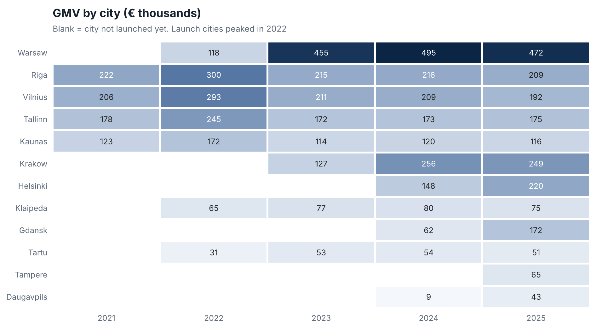
    </td>
    <td width="1000" valign="top">
      <h3>GMV by Cuisine</h3>
      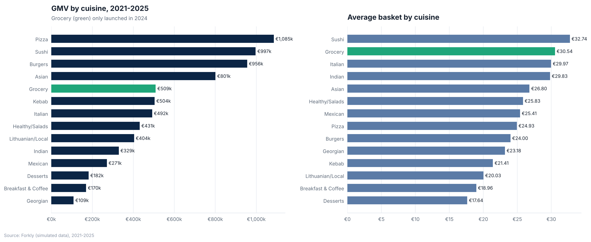
    </td>
  </tr>
</table>

<h1 align="center">Marketing</h1>
<table align="center">
  <tr align="center">
    <td width="1000">
      <h3>Spend and Cost per Signup</h3>
      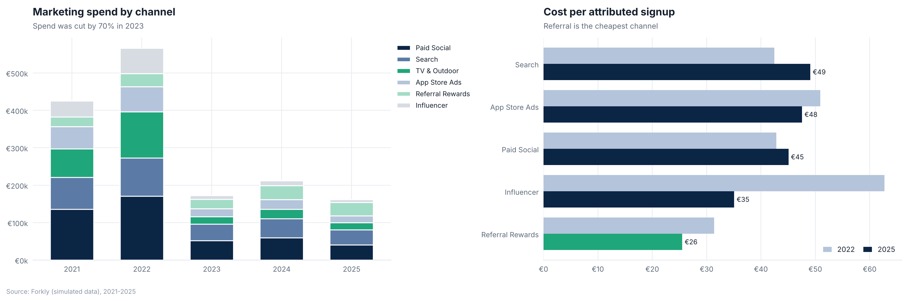
    </td>
    <td width="1000">
      <h3>New Customers by Channel</h3>
      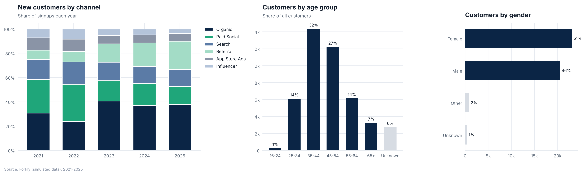
    </td>
  </tr>
</table>
<table>
  <tr>
    <td valign="top" width="500">
      <ul>
        <li>Marketing spend peaked at <strong>€566K in 2022</strong> and fell to <strong>€162K in 2025</strong>. In 2021 and 2022 it was larger than all of Forkly's net revenue.</li>
        <li>CAC peaked at <strong>€43.60 in 2022</strong> and fell to €27.00 in 2025.</li>
      </ul>
    </td>
    <td valign="top" width="500">
      <ul>
        <li><strong>Referral rewards</strong> are the cheapest channel at about <strong>€26 per signup</strong> in 2025. Search, paid social and app store ads cost €45–49.</li>
        <li>TV and outdoor ads bring no trackable signups, so their effect cannot be measured from this data.</li>
      </ul>
    </td>
  </tr>
</table>

<h1 align="center">Delivery Operations</h1>
<table align="center">
  <tr>
    <td width="500">
      <div align="center">
        <h3>What a Late Delivery Costs</h3>
        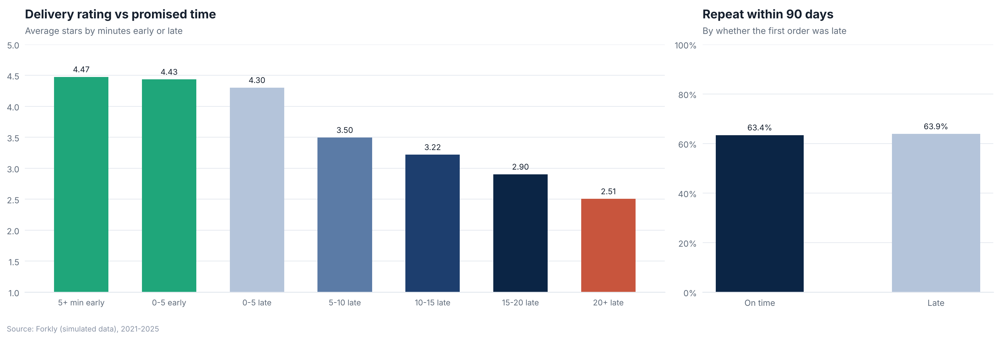
      </div>
    </td>
    <td valign="top" width="500">
      <ul>
        <li>Delivery ratings stay between 4.3 and 4.5 until an order is more than 5 minutes late. Then they drop fast: <strong>3.5 at 5–10 minutes late</strong> and <strong>2.5 at 20+ minutes late</strong>.</li>
        <li>A late first order does not change whether a customer orders again within 90 days (61% either way), so the damage shows up in ratings, not repeat orders.</li>
        <li>Average delivery time rose to <strong>39.1 minutes in 2022</strong> and fell to <strong>30.7 minutes in 2025</strong>.</li>
      </ul>
    </td>
  </tr>
</table>
<table align="center">
  <tr align="center">
    <td width="1000">
      <h3>Delivery Time and Late Rate</h3>
      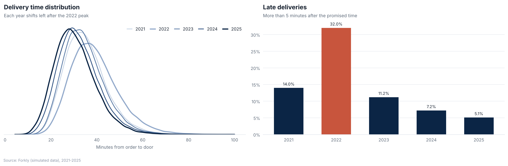
    </td>
    <td width="1000">
      <h3>Weather</h3>
      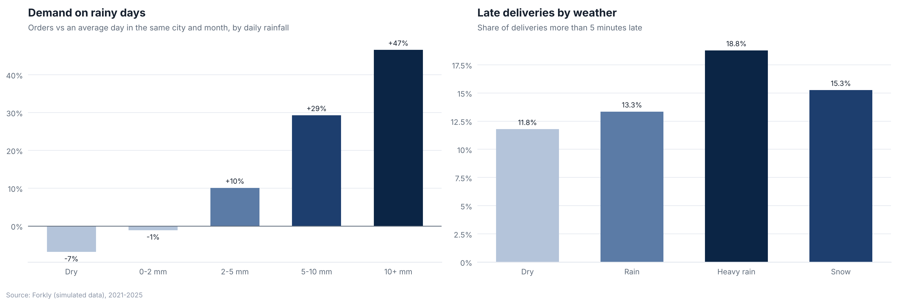
    </td>
  </tr>
</table>
<table>
  <tr>
    <td>
      <ul>
        <li>The late rate rises from <strong>11.8% on dry days to 18.8% in heavy rain</strong>. Days with 10+ mm of rain have <strong>47% more orders</strong> than average, so couriers are short exactly when demand peaks.</li>
        <li>E-bikes grew from 11% to <strong>38% of deliveries</strong> and replaced bicycles as the main vehicle.</li>
        <li>"No courier available" was the top cancellation reason in 2022 (1,646 orders, 29% of cancellations). In 2025 it caused only 187.</li>
        <li>Support tickets fell from 8.9 per 100 orders in 2022 to <strong>2.4 in 2025</strong>, and the median resolution time from 31 hours to 1 hour.</li>
      </ul>
    </td>
  </tr>
</table>
<div align="center">
  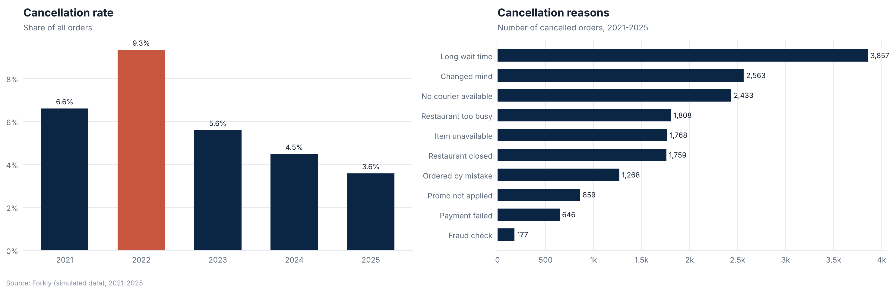
</div>

<h1>Recommendations</h1>
<h4>Based on these insights, here are actions the business can take.</h4>
<ul>
  <h3>Growth</h3>
  <li>Plan new city launches around courier capacity, not only marketing.
    <ul>
      <li>The 2022 expansion pushed the late rate to 32% and cancellations to 9.3%, and year-over-year retention fell from 90% to 71%.</li>
    </ul>
  </li>
  <li>Keep expanding grocery and the newer cities.
    <ul>
      <li>Grocery reached 17% of GMV within two years, and newer cities bring 66% of GMV while the launch cities are flat.</li>
    </ul>
  </li>
  <h3>Unit Economics</h3>
  <li>Keep promotions for first orders and win-back campaigns only.
    <ul>
      <li>Promo first orders repeat 7–10 pp more often, while blanket discounts cost 6.9% of GMV in 2021.</li>
    </ul>
  </li>
  <li>Review the Plus free-delivery benefit, for example with a minimum basket.
    <ul>
      <li>Contribution margin fell 1.3 pp in 2025 as Plus grew to 42% of orders.</li>
    </ul>
  </li>
  <h3>Customers</h3>
  <li>Offer a Plus trial to the At Risk and Needs Attention RFM segments.
    <ul>
      <li>Together they are 9% of customers, and Plus members order more than twice as often as non-members.</li>
    </ul>
  </li>
  <h3>Marketing</h3>
  <li>Move budget from search and TV toward referral rewards.
    <ul>
      <li>In 2025 a referral signup cost about €26, against €45–49 for search, paid social and app store ads.</li>
    </ul>
  </li>
  <h3>Operations</h3>
  <li>Set the delivery promise so orders arrive no more than 5 minutes late.
    <ul>
      <li>Ratings drop from 4.3 to 3.5 once an order is 5–10 minutes late.</li>
    </ul>
  </li>
  <li>Add couriers and rain bonuses on wet days.
    <ul>
      <li>Heavy rain raises the late rate to 18.8%, and demand is 47% higher on days with 10+ mm of rain.</li>
    </ul>
  </li>
</ul>

<h1>Technical Details</h1>

<h3>Pipeline</h3>

| Step | File | What it does |
|---|---|---|
| 0 | `src/theme.py` | Chart style: navy, white and green palette, matplotlib theme, number formats |
| 1 | `src/load.py` | Project paths, reads the 15 raw or cleaned CSVs with the right date columns |
| 2 | `src/clean.py` | Fixes 15 data quality issues, checks 13 foreign keys, logs every cleaning rule |
| 3 | `src/analysis.py` | Builds 24 analysis tables: KPIs, unit economics, cohorts, RFM, promotions, operations, marketing |
| 4 | `src/dashboard.py` | Five-page dashboard as one HTML file with a navigation bar, plus PNG pages and a PDF |
| 4b | `src/dashboard_dash.py` | Interactive four-page Dash and Plotly app with year and city filters |
| 5 | `run_all.py` | Runs steps 2–4 in order, with timing. `--notebooks` also re-runs the notebooks |
| – | `notebooks/01_cleaning.ipynb` | The cleaning step explained cell by cell |
| – | `notebooks/02_exploration.ipynb` | Exploratory analysis: trends, distributions, seasonality, correlations (15 charts) |
| – | `notebooks/03_analysis.ipynb` | Business analysis: unit economics, retention, RFM, Plus, promotions, marketing (12 charts) |

<h3>Data Cleaning</h3>

| Table | Issue | Rows | Fix |
|---|---|---:|---|
| orders | Duplicated rows (some differ only by casing) | 1,200 | Standardised text, then dropped |
| orders | `platform` in the wrong case | 3,573 | Mapped to iOS / Android / Web |
| orders | `payment_method` in uppercase or with a trailing space | 2,417 | Trimmed and mapped |
| orders | `total_amount` on cancelled orders still includes the tip | 4,853 | Recalculated |
| customers | `signup_date` in DD/MM/YYYY format | 884 | Parsed separately |
| customers | Age outside 16–100 | 45 | Set to missing |
| customers | Gender spelled F / female / blank | 2,642 | Standardised |
| customers | First order before the signup date | 3 | Signup moved to the first order date |
| restaurants | Cuisine casing and trailing spaces | 238 | Standardised |
| order_items | Missing `unit_price` and `line_total` | 1,324 | Filled with the same item's price that year |
| deliveries | `delivery_minutes` ≤ 0 or > 180 | 220 | Recalculated from timestamps |
| deliveries | Missing `courier_id` | 848 | Kept and flagged |
| reviews | Food rating outside 1–5 | 90 | Set to missing |
| support_tickets | Resolved before created | 53 | Recalculated from resolution hours |
| marketing_spend | Missing `spend_eur` | 25 | Interpolated within channel |

<h3>Dashboards</h3>

There are two versions of the dashboard: an interactive Dash app and a static HTML report.

<strong>Interactive dashboard (Dash + Plotly)</strong>

`src/dashboard_dash.py` runs a local web app with four pages: Overview, Customers, Restaurants & Operations, and Marketing & Unit Economics. A year picker updates the KPI cards against the year before, a city filter updates the city charts, and every chart shows exact values on hover. Each page ends with the key takeaways.

<table align="center">
  <tr align="center">
    <td width="1000">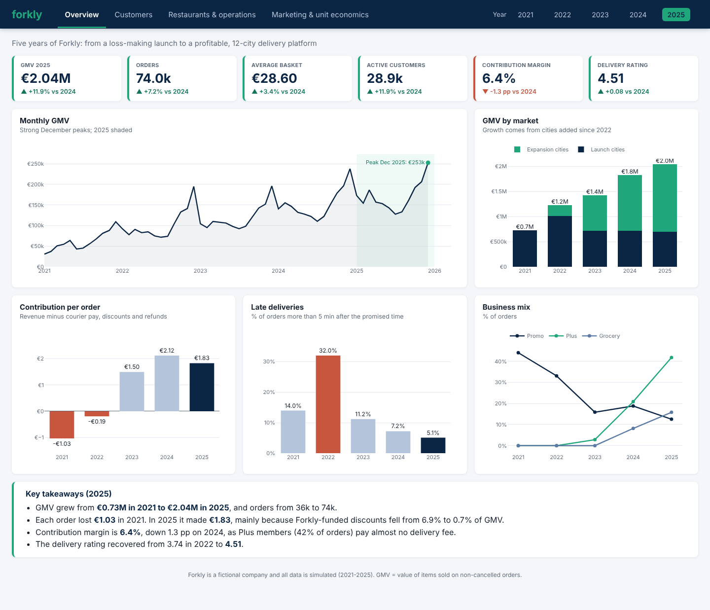</td>
    <td width="1000">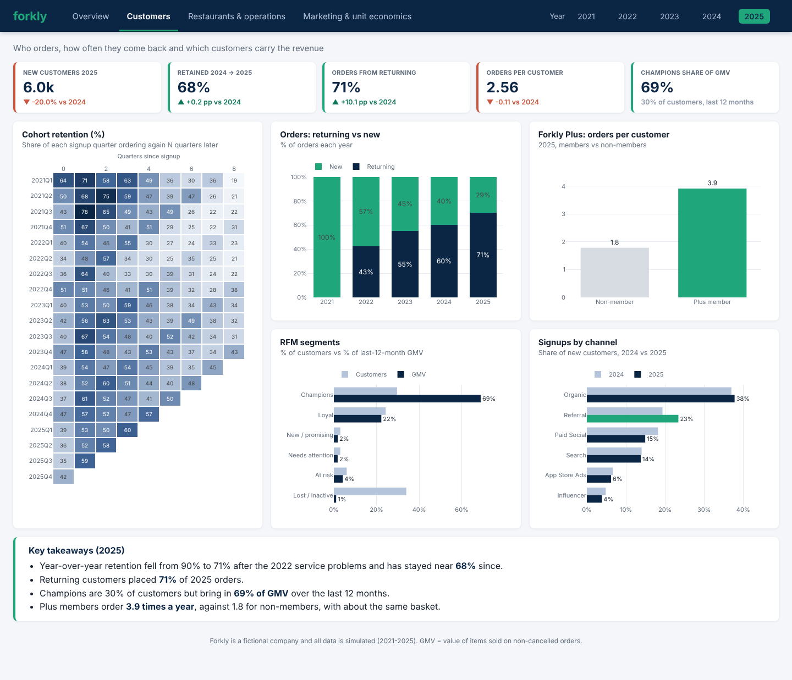</td>
  </tr>
  <tr align="center">
    <td width="1000">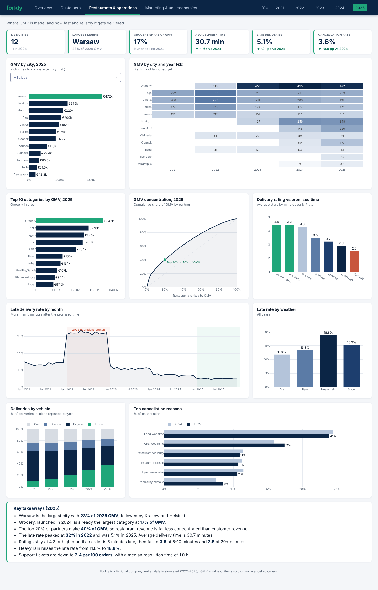</td>
    <td width="1000">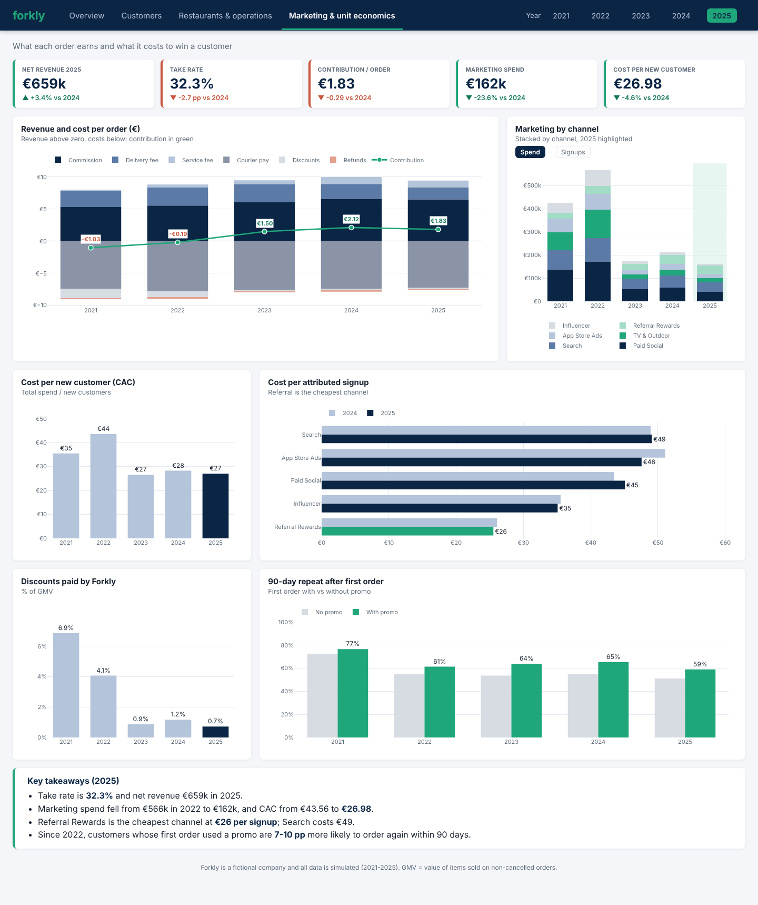</td>
  </tr>
</table>

<strong>Static report</strong>

`output/dashboard/Forkly_dashboard.html` is a single self-contained file that needs no server. A navigation bar switches between five pages: Overview, Customers, Restaurants, Operations and Marketing. Each page has a row of KPI cards, six charts and written key takeaways. The takeaways are calculated from the same tables as the charts. The same pages are also saved as PNG files and as one PDF.

<div align="center">
  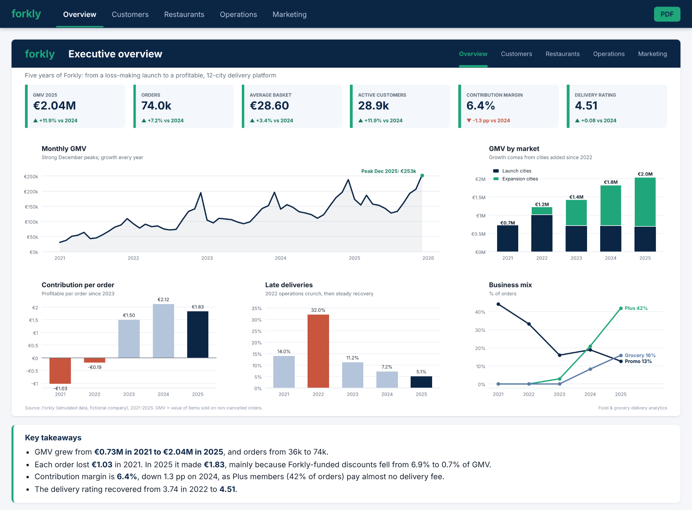
</div>

<h3>How to run</h3>

1. Clone the repository and open the `forkly-delivery-analytics` folder in VS Code or a terminal.
2. Add `orders.csv` and `deliveries.csv` to the `Data/` folder (see Data Availability below).
3. Install the packages: `pip install -r requirements.txt`
4. Run `python run_all.py`. It takes about 15 seconds, or about one minute with `--notebooks`.
5. Open `output/dashboard/Forkly_dashboard.html` in a browser.
6. For the interactive dashboard, run `python src/dashboard_dash.py` and open http://127.0.0.1:8050.

Requirements: Python 3.10 or later, with `pandas`, `numpy`, `matplotlib`, `seaborn`, `plotly`, `dash` and `jupyter`.

<h3>Project structure</h3>

```
forkly-delivery-analytics/
├── Data/                  # raw CSV tables (orders and deliveries on request)
├── notebooks/             # 01_cleaning, 02_exploration, 03_analysis
├── src/                   # theme.py, load.py, clean.py, analysis.py, dashboard.py, dashboard_dash.py
├── output/
│   └── dashboard/         # Forkly_dashboard.html, Forkly_dashboard.pdf, 5 PNG pages
├── images/                # charts, ERD and screenshots used in this README
├── run_all.py
├── requirements.txt
└── README.md
```

`Data_clean/`, `output/tables/` and `output/figures/` are created by the pipeline and are not tracked.

---

<h3>Data Availability</h3>

Due to GitHub's file size limits, the two largest tables are not included in this repository:

| File | Size |
|---|---|
| `orders.csv` | 34 MB |
| `deliveries.csv` | 29 MB |

All remaining tables are in the `Data/` folder. The full dataset is available upon request. Feel free to reach out via [LinkedIn](https://www.linkedin.com/in/algirdas-vailionis) or [email](mailto:algirdas.vailionis@gmail.com).

<h3>Author</h3>

<strong>Algirdas Vailionis</strong>, Data Scientist · <a href="https://www.linkedin.com/in/algirdas-vailionis">LinkedIn</a> · <a href="mailto:algirdas.vailionis@gmail.com">Email</a>

---

> **Data disclaimer:** All data in this project is synthetic and was generated for portfolio and learning purposes. Company names, customers, transactions and results are simulated and do not represent any real organisation or individuals.

---
